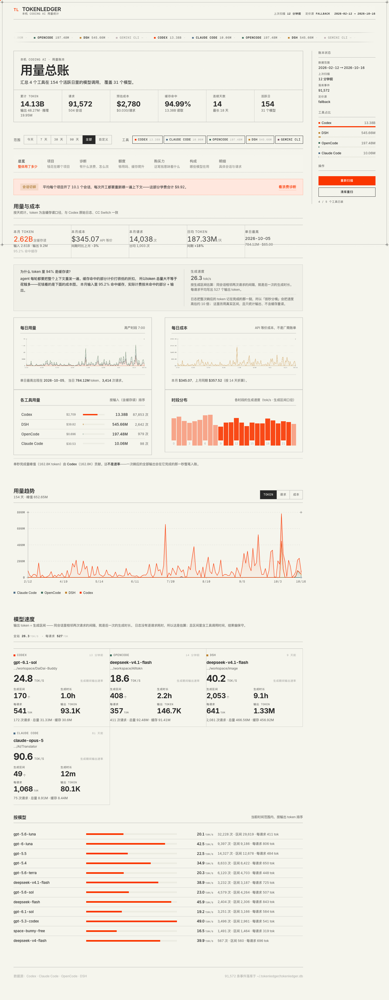
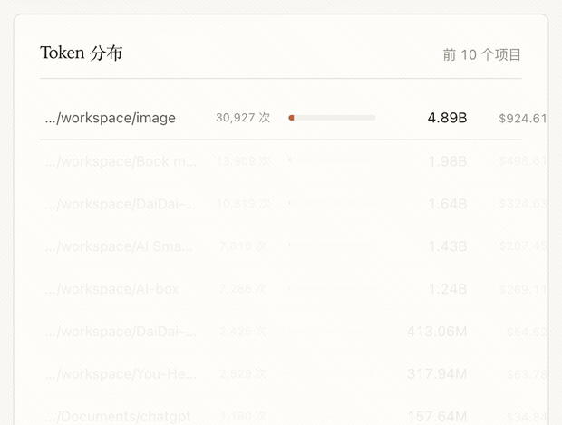
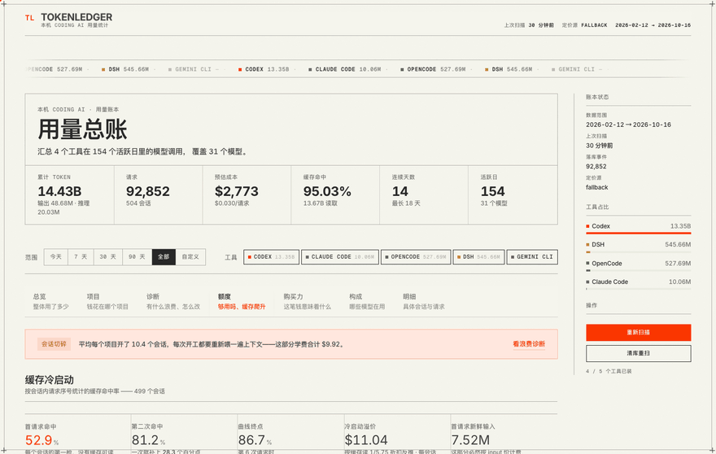
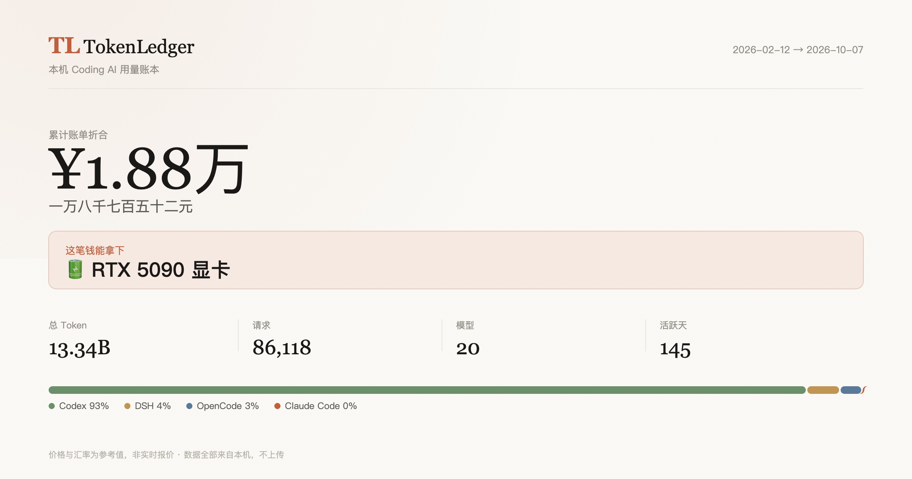
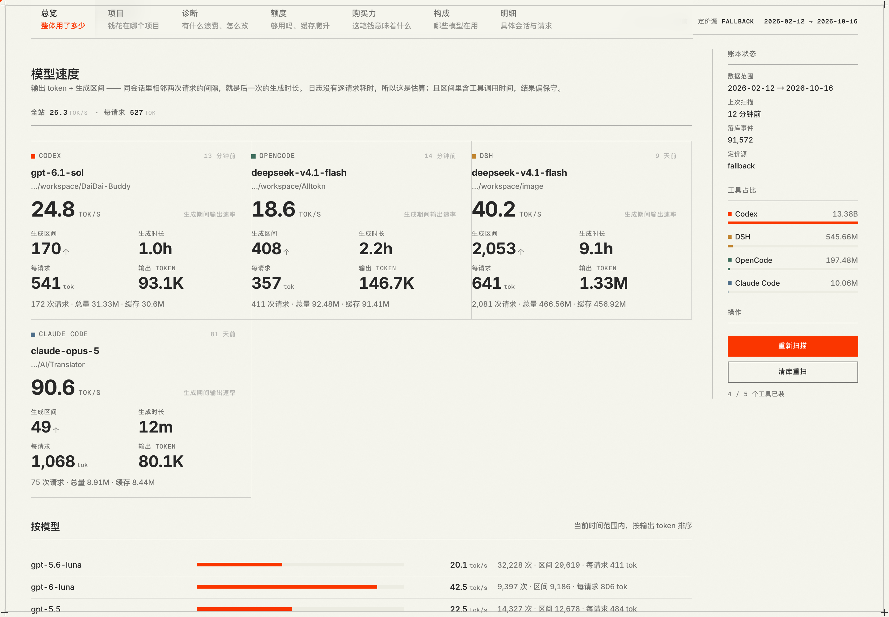

# TokenLedger

**Claude Code 和 Codex 的账单只给你一个总数。TokenLedger 读你本机已有的日志，
告诉你钱花在哪个项目、哪次缓存冷启动上多烧了多少。文件不联网，数据不上传。**

支持 **Codex**、**Claude Code**、**OpenCode**、**DSH (DeepSeek Harness)**、**Gemini CLI**
——本机日志在哪它就读哪，不挑工具。



## 钱花在哪个项目上

47 个项目，按 cwd 聚合。路径只在本机显示，界面上只留最后两段——
公司名和私有项目名不会出现在任何截图里。



## 会话切碎是缓存账单的主要来源

每个会话的第一次请求没有缓存可读，只能按 input 全价计费。
按会话内请求序号统计命中率，能看到它爬升的曲线——
并用首请求的实际混合单价反推这部分「冷启动溢价」。

本机实测：第 1 次 52.0% → 第 2 次 79.6% → 第 6 次 86.7%，
432 个会话的冷启动溢价合计 $8.44。把同一份上下文留在同一个会话里继续用，
比每次开新会话重新喂一遍划算得多。



## 你多花了多少，以及怎么改

上面的曲线是描述，这块是处方。

**碎片化指数 = 会话数 ÷ 唯一项目数**，就是「平均每个项目开了多少个会话」。
1.0 说明一个项目一个会话（理想），4.0 以上基本是「每次提问都新开会话」。
本机实测 9.5——平均每个项目开了 9.5 个会话，首轮学费合计 $7.60。

每条建议都带三件事：做什么、依据哪个数字、能省多少。不给「优化缓存」
这种没法执行的话。实测输出：

- **明显** — 把同一份上下文留在同一个会话里继续用，别每次提问都新开会话。可省 $7.60
- **轻微** — 优先改 …/workspace/image：它占了最多学费（193 个会话）。可省 $2.97
- **中度** — 看看 …/tmp/codex-probe 每次开工在读什么。可省 $0.12

## 这笔钱能买什么

累计 API 账单折成实物，16 件商品跨 6 个数量级。全部在本机计算，离线可用。

「分享这张账」在本机生成 PNG，「复制配文」直接给出配好的文字——发不发由你决定。



<!--
想发朋友圈的读者：上面这张卡片就是本机生成的产物。
数据全部来自本机日志，项目路径不进入卡片。
-->

界面复刻自 [heronaiapp.com](https://heronaiapp.com/) 的「**制图板**」设计语言：
暖象牙纸底 + 极淡颗粒、1px 发丝线切版面、**全大写 grotesque 标题**配**等宽大写微标签**、
橘红 `#fa3600` 作唯一强调色，一律方角、零投影。完整规格见 [DESIGN.md](DESIGN.md)。

动效同样照搬：GSAP + ScrollTrigger 的逐行遮罩揭示与滚动驱动固定区块、
Lenis 平滑滚动、6px 橘红跟随光标、填充式按钮；开机屏是一张
**接真实扫描进度的图纸规格表**。图表仍全部自绘 SVG，没有引入图表库。
字体 Inter + Geist Mono 自托管（OFL），**不联网**。

## 安装

**桌面应用**（推荐，无需 Node）：从 [Releases](https://github.com/Daidai-star/tokenledger/releases) 下载对应平台的安装包。

| 平台 | 安装包 | 说明 |
| --- | --- | --- |
| macOS (Apple Silicon) | `.dmg` | 未签名，首次打开需在「系统设置 → 隐私与安全性」放行 |
| macOS (Intel) | `.dmg` | 同上 |
| Windows (x64) | `.msi` / `.exe` | NSIS 安装器为当前用户安装，无需管理员 |

**自己跑**（需要 Node.js ≥ 24，用到内置的 `node:sqlite` 与 `node:zlib` 的 zstd）：

```bash
npm install
npm run build      # 构建前端
npm start          # 启动服务（首次启动会自动全量扫描）
# 打开 http://127.0.0.1:8787
```

开发模式（前端热更新）：

```bash
npm run dev        # vite:5173 + api:8787，/api 已配好代理
npm run desktop:dev  # Tauri 桌面应用（会先打包 sidecar）
```

不想起服务，只想要一份统计：

```bash
npm run scan                # 扫描并打印总览
npm run scan -- --tool codex   # 只扫某个工具
npm run reset               # 清库全量重扫
node server/cli.js stats    # 打印当前统计
node server/cli.js export out.json   # 导出 JSON
```

## 数据从哪来

每个工具都有本地日志，TokenLedger 只读这些文件，不做任何网络请求、不上传任何数据。

| 工具 | 数据源 | 拿到的指标 |
| --- | --- | --- |
| Codex | `~/.codex/sessions/**/rollout-*.jsonl` + `.jsonl.zst` | token_count 增量、模型（turn_context）、cwd、originator |
| Claude Code | `~/.claude/projects/**/*.jsonl` | assistant 消息的 usage（input/output/cache） |
| OpenCode | `~/.local/share/opencode/opencode.db` | assistant 消息的 tokens/cost/model |
| DSH | `~/.dsh/sessions/**/session.v4.jsonl.zstd` | assistant/message 的 usage、provider、model |
| Gemini CLI | `~/.gemini/tmp/**/*.json` | usageTokens |

> Codex 会把较老的会话压成 `.jsonl.zst`，内容与 `.jsonl` 完全一致。
> **两者都要读**——只认 `.jsonl` 会漏掉绝大部分历史（本机实测少采约 8.4B token）。
> `.bak` 是 zst 的备份副本，跳过以免重复计数。

### 口径归一化

各工具的日志结构不同，collector 负责把差异消化掉，产出统一的 `UsageEvent`：

- **`inputTokens` 一律表示「新鲜输入」**。Codex 的 `input_tokens` 实际包含 `cached_input_tokens`，采集时做了减法，与 OpenCode / Claude 的口径对齐，避免下游重复计费。
- **total = input + output + cacheRead + cacheWrite**。缓存读算进总量，否则 Codex 这种高缓存命中的工具会被严重低估。
- **Codex 的 token_count 是累计值**，取 `last_token_usage` 作为单次增量；`total_token_usage` 只用来交叉校验。
- **`event_id` 保证幂等**：重复扫描同一文件不会重复计数。
- **冲突时「补空不覆盖」**：本地库是历史归档，而源日志随时可能被工具自己裁剪
  （opencode 实测裁剪过：重扫时源库只剩 983 条消息）。所以 upsert 只补
  `NULL` / `unknown` 的字段（`cwd`、`model`、`provider`、`cost_usd`、耗时……），
  **不改写 token 计数与时间戳**——那些是账本上的既成数字。
  这样修好采集器后**重扫即可就地回填**，不需要删库重扫；
  也**绝不能**靠删库去回填：源已裁剪时删掉就真没了（2026-10-16 踩过，见 checklist）。

### 增量扫描

`file_cursors` 表记录每个文件读到哪个字节。下次扫描：

- 文件未增长且 mtime 未变 → 跳过
- 文件被截断（size < offset）→ 从头重读（靠 `event_id` 幂等兜底）
- JSONL 用字节级读取，只在完整行边界停下，多字节 UTF-8 跨块不会损坏

**游标与数据必须同时落盘。** 采集器把一个工具的事件先攒在内存里，
等 `scan()` 返回才批量入库；而游标若逐文件实时写入，进程中途被杀就会出现
「游标已推进、数据还在内存里」的窗口——重启后这些文件被当成未变更跳过，
数据永久丢失。所以游标先攒着，`insertEvents` 成功后才提交；collector 抛错则丢弃，
下次从头重读（`event_id` 幂等，不会重复计数）。`server/scanner.cursor.test.js` 锁住这个行为。

大文件优化：Codex 单个 rollout 文件可达数 GB，且 99% 的行是消息正文。
采集器用字节级 `bytesFilter` 粗筛，只对含 `"token_count"` 等标记的行付出 `JSON.parse` 成本。

zstd 有两种形态，处理方式不同：

- **Codex 的 `.jsonl.zst` 是单帧**，用内置 `zlib.createZstdDecompress()` 流式解压。
  实测 395 个文件（1.37 GB 压缩 / 约 5 GB 解压）全部为单帧。
  分片解压并定期让出事件循环，所以扫描期间 SSE 进度仍能实时刷出。
- **DSH 的 session 文件是多帧拼接的 zstd**，Node 内置 API 只解第一帧，
  所以优先走系统 `zstd -dc`，退化时按帧魔数切分逐帧解压。

本机全量扫描（461 个 Codex 文件 + 395 个 `.zst`）约 25 秒。

## 成本估算

日志自带成本时直接采信（OpenCode 的 `cost` 字段）。否则按 `USD / 1M tokens` 计价：

1. `~/.cc-switch/model-pricing.json`（与 cc Switch 同源，优先）
2. 内置价目表 + 家族兜底

家族兜底处理网关自定义命名（`gpt-6-luna`、`claude-opus-5`、`deepseek-v4.1-flash`），
这些没有公开价目，按最接近的公开档位估算，`cost_source` 标为 `builtin~est` 以示区分。

```
cost_source: reported        日志自带
             cc-switch       本地价目表命中
             builtin         内置表精确命中
             builtin~est     家族估算（不确定）
             unknown         无价目，成本按 0 计入并在 UI 提示
```

## 可视化

- **用量趋势** — 堆叠面积图，可切 Token / 请求 / 成本，点模型可下钻
- **Token 速率** — 见下节
- **项目账单** — 按 cwd 聚合的分布与明细，见下节
- **缓存冷启动** — 会话内请求序号的命中率爬升曲线，见下节
- **工具占比** — 环形图
- **Token 构成** — 缓存命中 / 新鲜输入 / 输出 / 推理 / 缓存写入
- **模型排行** — 按量排序，点击联动趋势图下钻
- **活跃热力图** — GitHub 风格年度热力图（Codex profile 的标志性视觉）
- **工具 × 模型矩阵** — 交叉热力，点击格子聚焦模型
- **时段活跃** — 24 小时分布
- **成本构成** + 工具明细表
- **最近会话 / 最近请求** — 实时事件流
- **购买力** — 见下节
- **分享卡片** — 见下节

## Token 速率（吞吐）

用量总量说明不了「强度」。速率统计回答的是：**你真正在写代码的时候，输出有多快。**



### 口径：生成区间

事件是「一次请求**完成**」的瞬时记录——整次响应的 token 全部落在完成的那一刻。
所以按时间分桶是量不出速度的，量到的其实是「每次响应多少 token」。

现在用**生成区间**估算：同一会话内按 `ts` 排序，相邻两次请求的间隔
就是后一次的生成时长，于是

```
tok/s = Σ输出 token ÷ Σ有效区间
```

区间过滤（依据实测分布）：`< 1s` 视为同批抖动剔除；`≥ 300s` 视为用户走开剔除
（只占 0.9%，但不剔除会把全站从 ~26 tok/s 拉到 0.8）。保留区间覆盖 **92.6%** 的样本。

区间里含工具调用与排队时间，所以这是**下限估计**——模型真实生成更快。

### 为什么换掉旧口径

| 旧口径 | 问题 | 偏差 |
| --- | --- | --- |
| 活跃分钟（分母 = 有请求的分钟数） | 一分钟记满 60 秒，哪怕实际只生成了 8 秒 | **低估约 7 倍** |
| 完成秒分桶（分母 = 有完成的秒数） | 整次响应被当成 1 秒 | **高估约 10 倍** |

两种旧口径曾在同一屏里同时出现，读数差 10 倍（251 vs 26.3 tok/s）。
现在全站统一到生成区间。

### 层级

| 层级 | 内容 |
| --- | --- |
| `latestByTool` | 每个工具**最近一次会话**的模型、tok/s、生成区间数 / 时长、每请求输出、总量与缓存量 |
| `byModel` / `byTool` / `byDay` / `byHour` | 同一口径的各维度速度 |
| `overall` | 全站 tok/s、区间数、生成时长、每请求输出 |

一次窗口扫描按 `(日, 时, 工具, 模型)` 分组（全历史只有 1,122 行，228ms），
其余维度在 JS 里汇总——分四次 `GROUP BY` 要 ~900ms。

本机当前读数：全站 **26.3 tok/s**，累计 85,552 个生成区间 / 473.6 小时生成时长，
每请求输出 524 token。按模型看 `gpt-5.3-codex` 49.0、`deepseek-flash` 45.9、
`gpt-6-luna` 42.6，而 `gpt-5.6-luna` 20.1、`gpt-6.1-sol` 19.1——
同一批 agent，模型之间能差 2.5 倍。

> **首 token 延迟（TTFT）目前拿不到**：92,852 条事件的 `latency_ms` / `ttft_ms` 全为 0。
> 唯一存在的真实延迟数据是 Codex `task_complete` 的 `time_to_first_token_ms`
> （实测 12.0s / 5.1s / 3.2s），尚未采集。

## 项目账单

总量只告诉你花了多少，按项目拆开才告诉你花在哪。`cwd` 从采集第一天就在库里，
但此前没有任何界面用它——这恰恰是唯一真正有 sense 的维度。

界面上给出五项指标（最大项目占比、最大项目 token、缓存命中最高/最低、成本合计）、
前 10 个项目的分布条、前 12 个项目的明细表。明细里的路径**只显示最后两段**
（`…/workspace/image`），完整 `cwd` 可能含客户名或内部代号。

顺带给出每个项目的缓存命中率：本机 47 个项目跨在 92%~98% 之间，
同一台机器不同项目能差 6 个百分点，说明上下文复用策略确实不同，是可优化的信号。

> 这一节刻意只在 `/api/projects` 提供，且**绝不进任何上传或分享路径**。

## 缓存冷启动

每个新会话的第一枪必然没有缓存可读，之后才逐步爬升。这是结构性的，不是配置问题，
所以这里不做「优化建议」，只把爬升曲线摆出来。

本机 432 个会话的实测曲线：

| 会话内第几次请求 | 缓存命中率 |
| --- | --- |
| 第 1 次 | 52.0% |
| 第 2 次 | 79.6% |
| 第 3 次 | 81.8% |
| 第 6 次 | 86.7% |

一次就补上 27.6 个百分点。结论很直接：**把同一份上下文留在同一个会话里继续用，
比每次开新会话重新喂一遍要划算得多，会话切碎是缓存账单的主要来源。**

「冷启动溢价」把这件事折成钱：用首请求的实际混合单价反推，
假设这份新鲜输入能以缓存读计费的话，本可省下多少。
432 个会话合计 $8.44，每会话约 $0.0195。折扣比例固定取 1/5.75
（Claude 缓存读相对 input 的价格比），这是估算而非账单，界面上如实标注。

口径上有两个坑，都写进了回归测试：

- **「首次」用 `ROW_NUMBER() OVER (PARTITION BY session_id ORDER BY ts, rowid)`
  而不是 `MIN(ts)`。** 并发请求会共享同一毫秒（实测平均 2.38 条，最多 225 条），
  用 `MIN(ts)` 做 JOIN 会把同一个会话重复计数 2.4 倍——417 个会话被算成 991。
- **排除 `total_tokens = 0` 的心跳行。** 它们不带用量，混进来会把
  「首次请求」错认成心跳。

## 购买力

把累计账单折算成实物——「这些 API 的钱能买什么」。纯本地计算，不联网。

```
累计账单折合 ¥2.00 万 / 二万零二十二元     每个编码小时 ¥54 · 累计 367 小时
已经能拿下  RTX 5090 显卡（侧视图线稿）
再攒 ¥2,778 就能拿下 碳纤维电动公路车 · 按日均 ¥24 算，再写 115 天
```

版面从「信息」排到「情绪」：

- **对数标尺** — 16 件商品横跨 ¥88 ~ ¥5800 万，跨 6 个数量级，
  所以位置一律用对数比例（线性轴上便宜的会全挤在左边）。
  买得起的刻度实心珊瑚色，买不起的灰点，「你在这里」标出当前站位。
- **时间换算** — 把金额翻译成自己的时间：整笔账单摊销到「每个编码小时」多少钱，
  以及每件商品「≈ 你多少小时」。同一个数字，换成小时就有了重量。
  分母用**活跃分钟之和**（367 小时），不是 `rate.overall.activeHours`——后者是
  「有请求完成的秒数 / 3600」，只有 24 小时，拿它当分母会算出 ¥848/小时。
- **下一个目标** — 最便宜的买不起的那件，配进度条 +「再写 N 天」
  （按最近 30 天的日均成本）。留白比成就更有牵引力，所以给它单独一整条。
- **购物车** — 「如果真拿这笔钱去买」。先给每件买得起的都来一件
  （由便宜到贵，尽量凑齐品类），再用零钱回头补最便宜的。
  旁边有个 **「乱花一通」**：把最优解换成一次按单价加权的随机挥霍。
  算计了 16 件商品的价格之后，人其实更想看看「不管了随便买」是什么样。
- **图录** — 每件一张卡片：手绘线稿 + 目录编号 + 价格（和折合小时数）；
  买得起的点亮并给出「能买 N 件」，买不起的压淡，但给一条**进度条**而不是
  干巴巴的差额——看着条子已经走到 88%，比看到一个金额更想把它填满。

购物车不用纯贪心「从便宜往贵买到钱花完」：那会把整笔预算砸在最便宜的单一商品上
（实测 ¥18,842 全变成 214 包咖啡豆，购物车退化成一行，信息量归零）。
「乱花一通」同理，按**单价加权**挑商品，否则随机也会退化成一百多包咖啡豆。

价格是 2026 年国内**参考零售价**，汇率取固定的 `1 USD = ¥7.2`（非实时），
两者都在界面上标注清楚。这是个趣味估算，不伪装成精确报价。

### 商品图标

界面里**不用 emoji**：emoji 是字体，形状由系统决定（macOS / Windows / Android
各不相同），颜色固定、无法跟随主题，小尺寸下细节还会糊成一团。

16 件商品各画一张 SVG 线稿（`web/src/mall-icons.ts`），统一约定：
32×32 网格、描边 1.4、圆头圆角、图案收在 3..29 之间留下光学边距、
颜色一律 `currentColor`。所以买不起的商品压一层 `opacity` 就自动变淡，
不需要另画一套。

分享卡片要把同一个图标画进 canvas，而 canvas 不认 JSX——所以线稿同时提供
`iconDataUrl()`，序列化成 **data URL** 再 `drawImage`。data URL 不产生网络请求，
和「不联网、不上传」的定位一致。

## 分享卡片

点「分享这张账」在本机画一张 PNG（Canvas 2D，2400×1260），
含累计消费力、四个核心指标、工具占比条，底部注明「数据全部来自本机，不上传」。

没用 html2canvas 或 SVG `foreignObject`：后者在 Windows WebView2 里常因字体与
CSS 继承而失真，而引入第三方库会破坏「零依赖、纯本地」的定位。
代价是排版手写，但卡片布局是固定的。

**生成后存到本地，由用户自己决定发不发。** 不经过任何服务器。

## 流程动画

`采集流程` 面板把扫描过程做成可视流水线：

`检测工具 → 解析日志 → 写入存储 → 聚合 → 完成`

- 阶段节点依次点亮，连接线填充
- 进度条按文件数推进，带流光
- 正在处理的工具高亮，节点呼吸 + 圆点脉冲
- 进度通过 SSE（`/api/scan/stream`）实时推送，扫描完成后自动刷新数据

其余动效：入场淡入上移、数字滚动、条形图生长、环形图弧线扫出、
hover tooltip、状态切换过渡；并遵循 `prefers-reduced-motion`。

## 架构

```
server/
├── model.js              UsageEvent / Collector 契约（扩展点）
├── pricing.js            成本估算
├── store.js              SQLite：事件表、游标、扫描记录、日聚合
├── scanner.js            扫描编排 + 进度事件
├── queries.js            聚合查询
├── index.js              HTTP 服务 + SSE
├── cli.js                命令行
└── collectors/
    ├── util.js           遍历 / 增量 JSONL 读取 / zstd 流式解压 / 字节过滤
    ├── codex.js  claude-code.js  opencode.js  dsh.js  gemini.js
    └── index.js          注册表
web/src/
├── App.tsx               页面编排、筛选、账本抬头、右边栏
├── motion/               动效层（GSAP + ScrollTrigger + Lenis）
│   ├── gsap.ts           插件注册 / prefers-reduced-motion / 触屏判定
│   ├── smoothScroll.ts   Lenis 平滑滚动 + 程序化定位（切栏定位走这里）
│   └── effects.ts        标题逐行揭示 / 图纸框画线 / 固定滚动区块 / 顶栏收走
├── mall.ts               购买力换算（纯函数，含金额与中文数字格式化）
├── mall-icons.ts         16 件商品的手绘 SVG 线稿（纯数据 + data URL 序列化）
├── share.ts              分享卡片绘制（Canvas 2D）
├── components/
│   ├── Boot.tsx          开机屏：图纸规格表，接真实扫描进度（SSE）
│   ├── Deco.tsx          视口图纸框：4 条发丝线 + 四角定位十字
│   ├── Cursor.tsx        自定义光标：6px 橘红跟随点
│   ├── Marquee.tsx       工具条跑马灯
│   ├── Charts.tsx        自绘 SVG 图表集（趋势/排行/环形/柱状/热力/矩阵）
│   ├── Insights.tsx      项目账单 / 缓存冷启动 / 浪费 / 护栏 / 额度
│   ├── Mall.tsx          购买力区
│   ├── MallIcons.tsx     商品图标的 React 渲染（吃 mall-icons.ts 的数据）
│   └── ScanFlow.tsx      采集流程（滚动驱动的固定区块）
├── api.ts  format.ts  types.ts  styles.css
web/public/fonts/         自托管 Inter + Geist Mono（latin 子集，SIL OFL）
scripts/
├── build-sidecar.mjs     打包桌面应用用的 sidecar
└── build-sidecar.test.js 参数解析契约的回归测试
desktop/src-tauri/
├── src/main.rs           极薄外壳：选端口 / 拉起后端 / 健康检查 / 开窗口 / 退出时回收
├── tauri.conf.json
└── Cargo.toml
```

后端零运行时依赖：SQLite 用 Node 内置 `node:sqlite`，zstd 用 `node:zlib`，HTTP 用 `node:http`。
前端图表全部自绘 SVG，没有引入图表库。

### 桌面应用架构：Tauri 薄壳 + Node sidecar

为什么不是 Electron：整个后端（8 GB 日志解析、多帧 zstd、SQLite 聚合）是零依赖的
Node 实现，重写一遍不划算。所以**保留 Node，把 Tauri 只当壳**——Rust 侧只做四件事：

1. 挑一个空闲端口
2. 拉起打包进来的 Node 运行时，跑 `server.mjs`
3. 轮询 `/api/health`，确认后端就绪
4. 打开系统 WebView 指向该端口；退出时杀掉子进程

健康检查用 `std::net` 直接发 HTTP，不引入 `reqwest`。

体积对比（实测）：

| | DMG |
| --- | --- |
| 本方案（Node 114 MB + Tauri 壳 4.1 MB） | **37.9 MB**（gzip 36 MB） |
| Electron | ~85 MB |

sidecar 由 `scripts/build-sidecar.mjs` 生成：`esbuild` 把后端打成单文件
`server.mjs`、拷贝 `dist/` 前端产物、下载对应平台的 Node 运行时。
用 `--platform` / `--arch` 支持交叉架构（CI 构建 Intel 包时必需）。

## 扩展一个新工具

实现 `Collector` 契约，加进 `collectors/index.js` 即可，存储/聚合/API/前端都不用改：

```js
// server/collectors/mytool.js
import { UsageEvent, Collector } from "../model.js";
import { walkFiles, readJsonlIncremental, toTs, hashId } from "./util.js";

export const mytool = new Collector({
  id: "mytool",
  name: "My Tool",
  color: "#ff6b6b",
  roots: ["/path/to/logs"],
  detect: () => true,
  async scan(ctx) {
    const events = [];
    for (const file of walkFiles(ctx.roots.mytool, { exts: [".jsonl"] })) {
      const cur = ctx.cursor("mytool", file);
      const res = readJsonlIncremental(file, cur.reset ? null : cur, (obj) => {
        events.push(new UsageEvent({
          id: hashId("mytool", obj.requestId),  // 幂等键
          tool: "mytool",
          ts: toTs(obj.timestamp),
          model: obj.model,
          inputTokens: obj.usage?.input || 0,
          outputTokens: obj.usage?.output || 0,
        }));
      });
      ctx.advance("mytool", file, res);       // 保存游标
      ctx.emitProgress("mytool", events.length, 1, 1);
    }
    return { events, stats: { filesSeen: 1, filesParsed: 1 } };
  },
});
```

`ctx` 提供：`cursor()` / `advance()` / `session()` / `emitProgress()`。

## API

| 端点 | 说明 |
| --- | --- |
| `GET /api/dashboard` | 首屏全量数据 |
| `GET /api/overview` | 总览指标 |
| `GET /api/timeseries` | 时间序列（`?byTool=true` 按工具拆） |
| `GET /api/by-model` | 模型排行 |
| `GET /api/by-tool` | 工具对比 |
| `GET /api/matrix` | 工具 × 模型 |
| `GET /api/hourly` `?weekday` | 时段分布 |
| `GET /api/rate` | Token 速率统计 |
| `GET /api/projects` | 按 cwd 聚合的项目账单（见下节） |
| `GET /api/cold-start` | 缓存冷启动诊断（见下节） |
| `GET /api/waste` | 浪费诊断：会话碎片化与可执行建议（见下节） |
| `GET /api/guard` | 预算护栏：单会话成本分布与超线会话 |
| `GET /api/pace` | 额度视角：按当前速度投影到月末 |
| `GET /api/sessions` `?events` | 会话 / 事件流 |
| `GET /api/profile` | 档案（streak、强度） |
| `GET /api/profiles/:tool` | 单工具账号信息 |
| `POST /api/scan` | 触发扫描 |
| `POST /api/reset` | 清库重扫 |
| `GET /api/scan/stream` | SSE 扫描进度 |

通用参数：`from` / `to`（YYYY-MM-DD）、`tools`（逗号分隔）、`limit`。

## 测试

```bash
npm test           # 137 个用例
npm run typecheck
```

覆盖：

- **增量读取** — 截断 / 跨块 UTF-8 / 坏行 / 去重
- **zstd 流式解压** — 跨块边界不截断行、末尾无换行的最后一行、字节过滤、损坏文件抛错
- **游标提交时机** — collector 崩溃时不提交游标、崩溃后重跑能补齐数据
- **定价** — 缓存不重复计费 / 家族兜底
- **幂等写入**、聚合与主键冲突、查询筛选、streak 计算
- **扫描编排** — 并发保护 / 错误隔离 / 增量跳过 / reset
- **速率统计** — 分钟分桶、中位数与 P95、峰值归属
- **项目账单与冷启动** — cwd 聚合、缓存命中率爬升曲线、首请求口径不重复计数
- **购买力换算** — 金额守恒、品类多样性、零/负/非法预算、中文数字读法
- **sidecar 参数解析** — `--key=value` 与 `--key value` 两种形式

`web/src/*.test.ts` 由 Node 内置的类型剥离直接运行，不参与 `tsc` 类型检查
（已在 `tsconfig.json` 中排除，否则 Node 全局会漏进浏览器代码）。

## 隐私

只读本机日志，**不发起任何网络请求，不上传任何数据**。数据库留在本地。
桌面应用把后端跑在 `127.0.0.1` 的随机端口上，不对外监听。

分享卡片在本机生成 PNG，存到本地后由用户自己决定发不发。

> 设计上刻意不做排行榜。coding agent 日志的敏感度远高于普通使用统计：
> `cwd` 常含公司名与私有项目名，上传时间序列足以反推作息与大致位置。
> 项目账单因此只在 `/api/projects` 本机提供，界面上路径只留最后两段，
> 分享卡片也不含这个维度。
> 如果以后要加，建议保持纯本地，最多做成与历史快照的对比。

截图与文档里的项目路径均为 `…/` 开头的相对展示，不含用户名或绝对路径。

## License

[MIT](LICENSE) © 2026 Daidai-star

## 数据存储

命令行模式下数据库在 `~/.tokenledger/tokenledger.db`（SQLite，WAL）。
删除该文件即可完全重置；`TOKENLEDGER_DATA` 环境变量可改位置。

桌面应用改用 Tauri 的 app data 目录：

- macOS `~/Library/Application Support/dev.daidai.tokenledger/data/`
- Windows `%APPDATA%\dev.daidai.tokenledger\data\`
